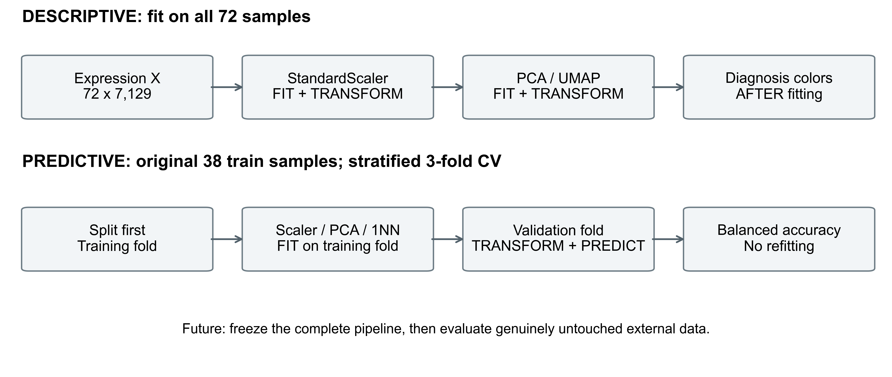
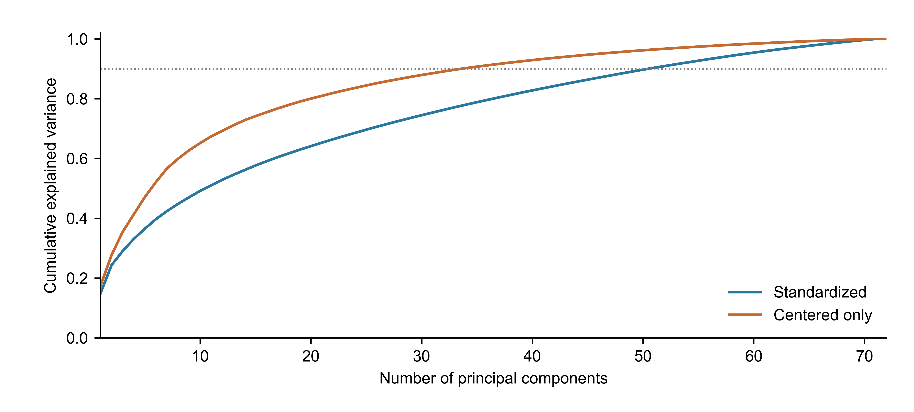
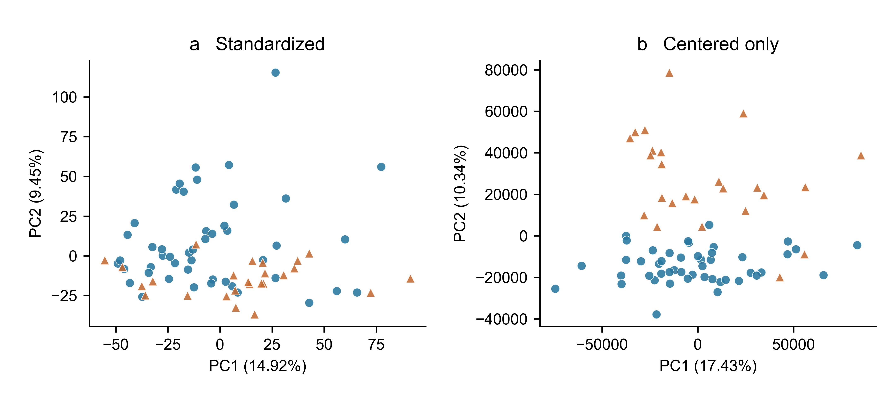
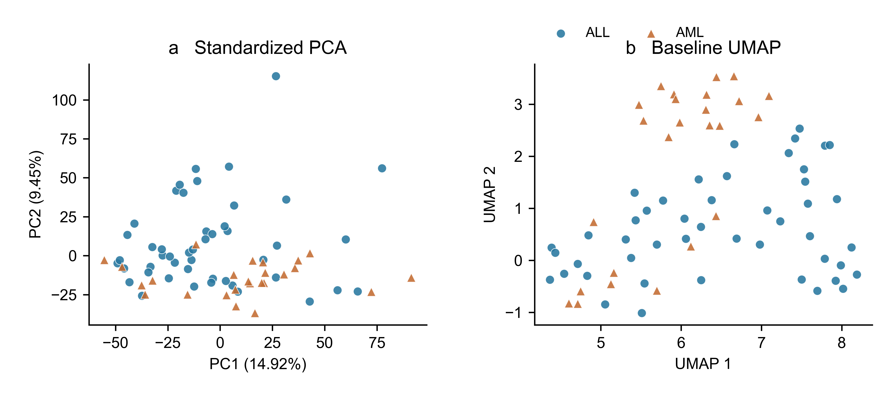
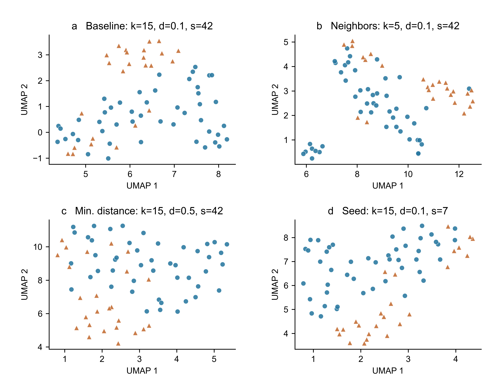

高维白血病表达数据的降维分析

PCA 的方差保留、UMAP 的邻域稳定性与预测证据边界

第4讲工作单分析报告 · 72份样本 / 7,129个探针 · 2026年10月27日

### 摘要

本文针对“二维降维图分离即可证明疾病机制并预测新患者”的判断，使用72份白血病微阵列表达谱，比较标准化与仅中心化 PCA、四种 UMAP 设置，并在原始38个训练样本内比较两个固定预测流程。标准化 PCA 的 PC1、PC2 分别解释14.92%与9.45%的方差，二维合计24.37%；仅中心化对照的二维解释率为27.77%。UMAP 基线保留原空间五近邻的平均比例为41.11%，改变邻居数、最小间距或随机种子均改变部分邻域关系。三折 balanced accuracy 均值从标准化1近邻的84.26%降至加入PCA(10)后的76.39%。这些结果支持将降维用于有损表示与结构探索，但不支持将图形分离升级为因果机制或新患者泛化证据。

关键词：主成分分析；UMAP；高维表达数据；信息泄露；邻域稳定性

### 0  问题、数据与分析范围

降维把高维观测映射到少数坐标；不同方法保存的信息不同，故“易于展示”与“适合预测”必须分别评价。本文以课程提供的 Golub 白血病数据为研究对象[1,2]，按任务1—4组织论证，给出数学定义、可复现实验及结论边界。分析旨在检验方法解释是否成立，不宣称发现新的疾病机制。

表1  样本构成与使用范围。ALL为急性淋巴细胞白血病，AML为急性髓系白血病。

| 范围 | 样本数 | ALL | AML | 用途 |
| --- | --- | --- | --- | --- |
| 全部样本 | 72 | 47 | 25 | 描述性PCA/UMAP |
| 原始训练部分 | 38 | 27 | 11 | 折内预测验证 |
| 原始测试部分 | 34 | 20 | 14 | 不计算预测成绩 |

每行是一份样本的微阵列表达谱；7,129列表示探针，包含控制探针，不等于7,129个不同基因。输入排除 sample_id、original_split、diagnosis 三个元数据列。矩阵为72×7,129，p/n=99.01；所有数值有限，无常量列、无完全重复的特征行，探针名唯一。数值范围为−28,400至71,369，含147,174个负值、1,615个零值，因此不直接取log或log1p，也不把非正值视为缺失。

初始判断：不同意题述推断；本报告对“现有图形证据不足”的分析信心记为95/100，这是判断确信度，不是统计置信水平，也不是对学习者原有心理状态的记录。最希望补充的是：预先锁定完整流程后，在真正独立且未参与探索的新队列上验证预测表现；机制判断还需干预证据。


---

## 1  任务1：明确降维目的与拟合范围

运行前预期：二维图可能揭示样本结构，却不能单独评价未来预测；PCA压缩可能改善或损害1近邻，本分析不预设改善方向。表2将每一种用途对应到可检验的输出，图1区分描述性与预测性流程。

表2  目标—输出—评价表。

| 目的 | 所需输出 | 如何判断有用 |
| --- | --- | --- |
| 可视化 | 二维/三维坐标与样本标识 | 可读性、参数敏感性及邻域保真；不能以类别最分离为唯一标准。 |
| 去噪 | 低维表示或重建矩阵 | 借助独立重复测量或下游验证；图变整齐与保留方差均不直接证明去噪。 |
| 压缩特征 | 少量坐标、投影矩阵与重建结果 | 累计解释率、相对重建误差、维数和成本之间的权衡。 |
| 发现样本结构 | 候选邻域、梯度或分组 | 跨参数稳定性、批次核查、独立生物信息和新数据复现。 |
| 后续模型输入 | 训练集拟合后可变换的新样本特征 | 完整折内Pipeline的验证表现；锁定方案后再作独立测试。 |

图1  两条流程及拟合范围。上：全部72份样本拟合标准化及降维，诊断仅在拟合后着色。下：先划分，再仅在训练折拟合标准化、PCA与分类器，验证折仅转换和预测；本次没有使用34份原始测试样本评分。



### 1.1  无监督处理为何仍可能泄露信息

即使PCA不使用诊断标签，均值、标准差和主成分方向仍依赖输入样本。如果先在全部样本拟合PCA再交叉验证，验证折已影响协方差估计和表示方向，后续评分对应的是“预先看过验证样本表达分布”的流程，而非仅从训练折学习的流程。泄露不必在每一次实验中都提高成绩，但它破坏了所要估计的独立预测条件[5]。

因此，描述性全数据拟合与预测性折内拟合是两个独立计算分支；不能把前者的Scaler或PCA对象带入后者。若已根据全部72例的图形选择方案，这34例也不能再被称为完全未见的确认性测试证据。


---

## 1.2  固定训练集内的预测对照

仅取 original_split=train 的38例，使用 StratifiedKFold(3, shuffle=True, random_state=42)。比较 StandardScaler→1NN 与 StandardScaler→PCA(10, svd_solver="full")→1NN；两个流程使用相同划分，每折都重新拟合完整Pipeline，不调参、不计算原始测试成绩。由于类别不平衡，使用两类召回率的算术平均：

$$
\mathrm{BA}=\frac{1}{2}\left(\frac{c_{\mathrm{ALL}}}{n_{\mathrm{ALL}}}+\frac{c_{\mathrm{AML}}}{n_{\mathrm{AML}}}\right).\tag{1}
$$

其中分母为该验证折各类样本数，分子为该类预测正确数。三折验证样本数为13、13、12；对应ALL/AML构成为9/4、9/4、9/3。训练样本数为25、25、26，故PCA(10)在每折均可定义。

表3  实际三折balanced accuracy。最后一列为加入PCA后的配对差值。

| 折 | 训练/验证 | 标准化1NN | 标准化PCA10→1NN | 差值/百分点 |
| --- | --- | --- | --- | --- |
| 1 | 25/13 | 0.819444 | 0.694444 | -12.50 |
| 2 | 25/13 | 0.875000 | 0.763889 | -11.11 |
| 3 | 26/12 | 0.833333 | 0.833333 | +0.00 |
| 均值 | — | 0.842593 | 0.763889 | −7.87 |

### 观察与解释

加入PCA(10)后，第1、2折分别下降12.50和11.11个百分点，第3折相同；平均下降7.87个百分点。本次预设对照没有显示PCA(10)改善1近邻。可能的解释是：截断低方差方向会改变原标准化空间的距离和近邻，其中可能包含预测相关信息；但本实验没有直接识别被丢弃的具体预测信号，因而只能把这一解释作为可能机制。

这并不证明所有PCA维数或所有分类器都会变差。三折来自同一小训练集，折间训练集重叠，不宜把三个分数当成独立人群的重复观测，并据此声称统计显著或临床优效。本报告不依据已看到的结果追加维数搜索。

### 结果支持的决策

若目的仅为展示，仍可采用PCA并明确二维压缩损失；若目的是新患者预测，应把是否降维及保留维数作为预先规定或嵌套验证中的方案选择问题。可视化解释率、图上分离和预测balanced accuracy分别回答不同问题，不应互相替代。

### 独立测试的最低条件

固定输入探针、缺失值规则、缩放、维数、分类器和评价指标后，再对未参与方案选择的新队列作一次外部验证。原始患者映射、中心与批次信息应同步核查；本数据的教学行号不是可独立核查的患者身份。


---

## 2  任务2：PCA 的数学定义与证明

### 2.1  标准化与方差目标

设X为n行p列的实数表达矩阵，其中n=72、p=7,129。对每个探针按列使用总体标准差（ddof=0）缩放：

$$
\mu_j=\frac{1}{n}\sum_{i=1}^{n}x_{ij},\quad s_j^2=\frac{1}{n}\sum_{i=1}^{n}(x_{ij}-\mu_j)^2,\quad z_{ij}=\frac{x_{ij}-\mu_j}{s_j}.\tag{2}
$$

本数据无零方差列。设Z的数值中心化版本为Zc=Z−1z̄ᵀ，定义样本协方差S=ZcᵀZc/(n−1)。StandardScaler使用n作分母，PCA样本方差使用n−1作分母，两者并不冲突；统一乘子在解释率中抵消。

$$
w_1\in\underset{\|w\|_2=1}{\operatorname{arg\,max}}\ w^TSw,\qquad t_1=Z_cw_1. \tag{3}
$$

命题1（最大方差方向）。设S的特征值按λ₁≥λ₂≥⋯≥0排列，PC1可取最大特征值对应的单位特征向量；最优投影样本方差等于λ₁。

证明。令S=QΛQᵀ，a=Qᵀw。因Q正交，∑aⱼ²=1，故wᵀSw=∑λⱼaⱼ²≤λ₁∑aⱼ²=λ₁，取最大特征值对应向量时达到上界。后续方向在与既有方向正交的约束下依次取得最大剩余方差。若最大特征值重根，最优方向不唯一。证毕。

### 2.2  解释率、重建误差与秩

$$
r_k=\frac{\lambda_k}{\sum_{\ell}\lambda_\ell},\quad R_m=\sum_{k=1}^{m}r_k,\quad \widehat Z_c=Z_cW_mW_m^T.\tag{4}
$$

命题2（截断PCA的重建误差）。前m个右奇异向量给出最优秩不超过m的Frobenius范数近似。证明要点：正交变换保持该范数，任何m维子空间最多保留前m个奇异值的平方和；选择对应子空间达到上界。残差能量为其余奇异值的平方和，由λₖ=σₖ²/(n−1)得

$$
\frac{\|Z_c-\widehat Z_c\|_F^2}{\|Z_c\|_F^2}=\frac{\sum_{k>m}\sigma_k^2}{\sum_k\sigma_k^2}=1-R_m.\tag{5}
$$

该式量化输入尺度上的信息损失，不把小方差自动视为噪声。标准化后每列总体方差为1，故每元素重建MSE等于1−Rₘ。

命题3（秩上界）。中心化矩阵满足1ᵀZc=0，列向量均位于ℝ⁷²中与1正交的71维子空间；因此rank(Zc)≤min(71,7,129)=71。虽然软件可返回72个成分，但末项仅为数值舍入量。

PC1最大化的是所选输入尺度上的总投影方差，不是ALL/AML分类差异，也不等于某个基因。若同时将w₁和t₁变号，则解释率、点间距离及重建均不变，只改变坐标朝向[3]。


---

## 2.3  方差保留与尺度敏感性

运行前预期：原尺度PCA可能被高方差探针主导；标准化会重分配各探针的相对影响。实测最大列均值绝对值为5.98×10⁻¹⁶，最大总体标准差偏离1为3.33×10⁻¹⁶，符合数值精度内的标准化要求。

表4  两种预处理的解释率。分母分别是各自处理后输入的总方差。

| 处理 | PC1 | PC2 | 前两轴合计 | 达到90%的维数 |
| --- | --- | --- | --- | --- |
| 按列标准化 | 14.9216% | 9.4462% | 24.3678% | 51 |
| 仅中心化 | 17.4278% | 10.3386% | 27.7664% | 34 |

图2  累计解释率曲线。灰色虚线为90%教学参考线，不代表生物信号保留阈值；两种曲线分别相对于各自输入尺度，不能据其高低直接判定方法优劣。



图3  标准化（a）与仅中心化（b）的PC1–PC2散点图。每图均包含72例；蓝色圆点为ALL，橙色三角为AML，标签均未参与PCA拟合。轴上百分比表示对应成分解释率。



标准化二维图舍弃75.6322%的输入方差，直接重建所得MSE=0.756322，与式(5)一致；数值秩为71，末项解释率约2.94×10⁻³²。两种尺度下类别均有重叠，二维图并不是高维结构的完整呈现。


---

## 2.4  探针权重与样本得分的可追踪解释

本报告严格将 components_.T 定义为方向权重（loading），每个方向的平方权重和为1；不采用“方向权重乘成分标准差”或“变量与成分相关系数”的其他定义。表5、6按PC1绝对权重排序，带符号保留当前数值实现的朝向。

表5  标准化PCA的PC1前5个探针。

| 探针 | 方向权重 | 原尺度总体标准差 |
| --- | --- | --- |
| X92518_s_at | +0.02878558 | 326.907 |
| X95190_at | -0.02817682 | 363.720 |
| X98253_at | +0.02792670 | 348.959 |
| X82895_at | +0.02787138 | 355.468 |
| Y09616_at | +0.02775694 | 531.144 |

表6  仅中心化PCA的PC1前5个探针。

| 探针 | 方向权重 | 原尺度总体标准差 |
| --- | --- | --- |
| M25079_s_at | +0.35238761 | 15782.799 |
| hum_alu_at | +0.31355189 | 10806.784 |
| HG1428-HT1428_s_at | +0.23486702 | 10956.526 |
| L06499_at | +0.21045324 | 7625.228 |
| J04617_s_at | +0.19625269 | 6846.936 |

两种处理的前5个探针没有交集。标准化前5个探针的原尺度标准差约327—531，而仅中心化前5个约6,847—15,783，说明尺度会显著改变主成分的组成。例如原尺度 M25079_s_at 的权重为0.35239，而标准化 PC1 最大绝对权重仅为0.02879；二者对应的变量尺度不同，不应直接把系数大小当作相同单位的生物效应。

$$
t_{i1}=\sum_{j=1}^{p}w_{j1}(z_{ij}-\overline{z}_j).\tag{6}
$$

对G001，探针 X92518_s_at 的标准化值为0.87682，权重为+0.02878558，因此对PC1贡献约+0.02524；X95190_at 的标准化值为−0.72228、权重为−0.02817682，贡献反而为+0.02035。前5项贡献之和为0.13507，其余7,124项合计26.97014，得到PC1得分27.10521。因此，仅展示最高权重探针不足以解释一个样本的全部PC1坐标。

### 尺度选择的作用与代价

按列标准化使每个探针以自身变异尺度计量，避免大尺度探针天然主导协方差；但除以很小的标准差也可能放大低变异测量噪声。微阵列上游归一化处理平台或样本间可比性，本文z-score处理列尺度，两者不是同一步骤；现有数据不支持宣称已重新完成上游归一化或批次校正。

对PC1的一句解释：PC1是全部标准化探针的单位权重线性组合，最大化本批样本的投影方差并解释其中14.92%。不能推出的一句结论：不能把PC1或高权重探针直接认定为白血病致病机制、最优分类方向或致病基因。


---

## 3  任务3：UMAP 的目标与解释边界

UMAP依据高维局部邻域构造加权图，再优化低维表示，使低维邻接关系与高维图尽可能一致[4]。其低维相似性可用下式概括；a、b由低维距离曲线拟合，不是基因效应参数：

$$
q_{ij}=\left(1+a\|u_i-u_j\|_2^{2b}\right)^{-1}.\tag{7}
$$

若高维模糊边权为pᵢⱼ，目标可概括为吸引与排斥项构成的交叉熵；实际实现使用随机优化及负采样，不意味着逐一精确求解全部成对项：

$$
\mathcal{L}=-\sum_{i<j}\left[p_{ij}\log q_{ij}+(1-p_{ij})\log(1-q_{ij})\right].\tag{8}
$$

表7  PCA与UMAP比较。

| 比较维度 | PCA | UMAP |
| --- | --- | --- |
| 映射与主要信息 | 线性正交投影；最大化保留方差 | 非线性嵌入；近似保持局部邻域图 |
| 坐标轴与解释率 | 方向权重可追踪；可报告方差解释率 | 轴无固定生物含义；无PCA式方差解释率 |
| 局部与全局距离 | 截断投影可能压缩距离，二维未必保留近邻 | 局部关系可探索；全局簇间距离、面积和密度不宜直接解释 |
| 参数与随机性 | 受缩放和维数影响；full SVD主要有符号不定性 | 邻居数、min_dist、度量与种子均影响嵌入 |
| 新样本预测 | 训练折fit，验证折transform | 使用支持transform的实现；同样只在训练折fit，验证折不得重新fit |

图4  同一标准化矩阵上的PCA与UMAP基线。每点是一份样本，颜色和形状只表示事后诊断标签。二维图只展示投影或嵌入中的模式，不提供独立预测准确率。



UMAP常用于单细胞或复杂表型展示，因为局部邻域可能无法由前两条线性方向充分表示；这是一种探索用途，而非亚型数量或机制已被证明的理由。


---

## 3.1  三项单因素对照

继续使用任务2的同一Z，不按诊断筛选探针。所有设置使用n_components=2、metric="euclidean"、n_jobs=1，其余参数保留所记录版本默认值。只改变一个因素，完整保留四幅图，不依据分组清晰度挑选展示。

表8  UMAP预设参数。

| 设置 | n_neighbors | min_dist | random_state |
| --- | --- | --- | --- |
| 基线 | 15 | 0.1 | 42 |
| 仅改邻居数 | 5 | 0.1 | 42 |
| 仅改最小间距 | 15 | 0.5 | 42 |
| 仅改随机种子 | 15 | 0.1 | 7 |

图5  UMAP参数与随机性对照。a为基线，b仅改变邻居数，c仅改变最小间距，d仅改变种子。蓝圆为ALL，橙三角为AML，每幅使用相同72例与全部7,129个探针；k、d、s分别表示邻居数、min_dist和随机种子。坐标轴范围不同，不能把图面尺寸解释为生物差异量。



观察：邻居数变为5后图形出现更明显的局部分段；min_dist增至0.5后点的铺展与间隔改变；种子变为7后整体朝向和局部位置也改变。各图仍可见类别富集区域与混杂样本，但没有一个稳定且事先定义的“岛屿数”估计。此处不实施聚类，也不把视觉岛屿命名为新亚型。

旋转、平移或翻转本身不会改变嵌入内的点间距离，因而仅看朝向变化不足以判断结构不稳定；更有意义的核查是比较同一样本的近邻成员。下一节以固定五近邻作定量检验。


---

## 3.2  近邻保真与跨设置稳定性

设Nᶻ₅(i)为原标准化7,129维欧氏空间中样本i的五近邻，Nᵉ₅(i)为某二维表示中的五近邻；均排除自身。定义原空间保留率R₅和相对UMAP基线的重合率S₅如下：

$$
R_5(e)=\frac{1}{72}\sum_i\frac{|N^Z_5(i)\cap N^e_5(i)|}{5},\quad S_5(e)=\frac{1}{72}\sum_i\frac{|N^{base}_5(i)\cap N^e_5(i)|}{5}.\tag{9}
$$

表9  72个样本的平均邻域比例。这是描述性指标，不是预测分数或统计置信区间。

| 二维表示 | 原空间五近邻保留率R₅ | 与基线重合率S₅ |
| --- | --- | --- |
| PCA前两轴 | 31.39% | 32.22% |
| UMAP基线 | 41.11% | 100.00% |
| UMAP邻居数5 | 45.56% | 55.28% |
| UMAP min_dist=0.5 | 40.00% | 64.17% |
| UMAP种子7 | 40.56% | 60.28% |

改变邻居数、最小间距和种子后，分别约44.72%、35.83%、39.72%的有向五近邻关系不再与基线一致。邻居数5的原空间保留率在本次四组中最高，但仍低于一半；不因此将其认定为最佳方法或追加选择。检验用的k=5是固定审计尺度，与UMAP建图参数n_neighbors不是同一参数。

表10  固定样本G001的近邻核查，完整72例记录另附CSV。

| 表示 | G001的五近邻（按距离排序） |
| --- | --- |
| high_dim | G016、G004、G072、G026、G007 |
| pca2 | G004、G028、G063、G030、G053 |
| baseline | G003、G004、G027、G049、G008 |
| neighbors5 | G004、G008、G003、G007、G049 |
| min_dist05 | G003、G004、G049、G027、G008 |
| seed7 | G004、G003、G008、G049、G017 |

G001在四种UMAP中始终邻近G003、G004、G008、G049；然而这四者只有G004属于其原空间五近邻。G004与G008各自的五近邻集合在四种UMAP中完全一致，而G010、G014没有跨四设置共同的五近邻。稳定性具有样本差异，并且“嵌入内稳定”不等于“对原空间保真”。

### 三条可支持／不可支持的判断

（1）可支持：本批表达谱中有与诊断着色相关的探索性邻域模式；不可支持：图形分离证明疾病机制或精确确定真实亚型数量。（2）可支持：部分近邻跨设置重现，另一些对参数敏感；不可支持：二维岛屿间距离、方向、面积或点密度可直接量化生物学差异。（3）可支持：这些图可提出待验证假设；不可支持：由图直接声称新患者预测性能或已排除批次效应。本数据缺少批次、中心及重复患者映射，无法完成相关排除。


---

## 4  任务4：团队结论、退出卡与课后作业

### 4.1  “主张—证据—推理—边界”四句话（退出卡）

主张：目前的二维图只能支持这72份样本的结构探索，不能证明疾病机制或新患者预测能力。证据：标准化PCA前两轴仅解释24.37%的方差，UMAP仅把邻居数15改为5就使与基线的五近邻重合率降至55.28%，而折内预测中PCA(10)的平均balanced accuracy低于无PCA对照。推理：前者表明二维线性表示存在大量压缩损失，后者表明非线性邻域依赖建图设置，因此图形分离既不是因果实验，也不是独立预测验证。边界：应先补全患者独立性与批次信息，再在预先锁定流程的外部队列复核预测；若主张某个探针相关基因构成机制，则还需可靠注释和有对照的功能干预，而不能从高loading直接推断。

### 4.2  作业一：PCA第一主成分代表什么？

第一主成分是让当前输入投影方差最大的单位线性方向，并由全部7,129个标准化探针共同构成。本次其解释率为14.9216%；例如X92518_s_at的方向权重为+0.02878558，在固定其他坐标的线性表达式中，该探针标准化值增加1会使PC1得分增加约0.02879。这个系数表示投影方向的组成，不表示因果效应、差异表达显著性或单基因诊断能力。整体翻转符号不改变其含义。

### 4.3  作业二：为什么PCA前要考虑标准化？

仅中心化保留每个探针原有变异尺度，因此高方差探针对总协方差的贡献往往更大。本次原尺度PC1的首位探针M25079_s_at标准差为15,782.80，而标准化PC1的首位探针X92518_s_at为326.91；两套前5个探针完全不同。标准化把各列总体方差统一为1，使尺度不再天然决定权重，但可能放大低变异噪声。原尺度二维解释率27.77%高于标准化的24.37%，因分母不同，这不构成原尺度更优的证明。

### 4.4  作业三：UMAP能说明什么，不能说明什么？

UMAP可显示在选定预处理、距离和参数下的候选局部关系，适合提出结构假设。仅把种子42改为7，与基线的五近邻重合率为60.28%，说明即使输入相同，部分细节仍会改变；G001跨四设置的共同邻居中又只有一个属于原空间五近邻。因而不能把稳定图形当作完全保真的生物结构，更不能直接从图中推断机制、亚型数、排除批次或证明泛化。

### 4.5  综合结论与建议

推荐将PCA与解释率作为可追踪的主要描述，并将四组UMAP及近邻核查作为补充；预测用途独立评价。在本次规定流程下，PCA实现了可量化的有损压缩，UMAP提供了参数相关的局部视角。二者都没有消除小样本、高维、缺少批次信息和外部验证带来的推断限制。


---

## 附录A  可复现性与提交索引

### A.1  数据、参数与软件

输入为课程原始leukemia.csv，保留全部72行和7,129个探针，未作诊断相关筛选、插补、对数变换或行列抽样。唯一排除项为三个元数据列。描述性标准化及PCA/UMAP拟合全部72行；预测分支重新从原始38个train样本开始，在每个训练折内拟合所有步骤。

数据SHA-256（与课程inspection.json一致）：

915bce00295ac470f6bd970a4032730a170a080642a5da53ab0bcb0545156f19

表A1  实际运行环境；数值线程设为1，未设置多进程拟合。

| 软件 | 版本 | 软件 | 版本 |
| --- | --- | --- | --- |
| Python | 3.12.14 | NumPy | 2.3.5 |
| pandas | 2.3.3 | SciPy | 1.17.1 |
| scikit-learn | 1.8.0 | umap-learn | 0.5.12 |
| Numba | 0.68.0 | llvmlite | 0.50.0 |
| Matplotlib | 3.10.8 | threadpoolctl | 3.7.0 |

PCA使用full SVD、whiten=False；预测PCA固定10维。UMAP所有显式及默认参数保存于umap-*-all-params.json。相同版本、数据顺序与随机种子用于复现；不同软件或线性代数实现仍可能产生符号或数值细节差异。

### A.2  交付内容与运行方法

analysis.py为完整分析源码；requirements.txt锁定数值分析依赖。原始数据、课程来源说明、参数、结果JSON、CSV坐标与邻域、交叉验证折编号及预测均收入提交包。重新运行生成的中间结果统一写入项目根目录.tmp/dimension-reduction/student-results/。

```python
python -m pip install -r submission/requirements.txt
python submission/analysis.py
```

上面的命令在提交包course目录执行。sample-coordinates.csv通过sample_id对应PCA与四种UMAP坐标；neighbors-by-sample.csv保留所有近邻；cv-fit-audit.json与cv-predictions.csv用于核查训练/验证隔离。PDF中的图均由真实输入计算生成，未使用合成样本。

### A.3  工作单覆盖核对

| 要求 | 报告位置 |
| --- | --- |
| 初始判断、数据单位及检查 | 摘要与第0节 |
| 任务1目标表、两条流程、泄露及可选预测 | 第1节，表2—3、图1 |
| 任务2标准化、推导、解释率、权重及尺度对照 | 第2节，表4—6、图2—3 |
| 任务3比较、三项对照、样本追踪及三条判断 | 第3节，表7—10、图4—5 |
| 任务4四句话、退出卡、三道作业 | 第4节 |
| 代码、参数、版本及实际结果 | 附录A—B与完整提交包 |


---

## 附录B  核心计算代码

以下代码概括实际执行的核心路径；完整源码还包含数据断言、图表输出、邻域审计及参数日志。三折逐折数值见表3，PCA实际结果见表4。运行前假定当前目录为course。

```python
import numpy as np
import pandas as pd
from sklearn.preprocessing import StandardScaler
from sklearn.decomposition import PCA
from sklearn.pipeline import make_pipeline
from sklearn.neighbors import KNeighborsClassifier
from sklearn.model_selection import StratifiedKFold
from sklearn.metrics import balanced_accuracy_score
from umap import UMAP

df = pd.read_csv("data/leukemia/leukemia.csv")
X = df.drop(columns=["sample_id", "original_split", "diagnosis"])
y = df["diagnosis"]
Z = StandardScaler().fit_transform(X)  # descriptive: 72 rows
pca = PCA(svd_solver="full").fit(Z)
scores = pca.transform(Z)
print(pca.explained_variance_ratio_[:2])
w = pd.Series(pca.components_[0], index=X.columns)
print(w.loc[w.abs().nlargest(5).index])
raw = PCA(svd_solver="full").fit(X)
for k, d, seed in [(15, .1, 42), (5, .1, 42),
                   (15, .5, 42), (15, .1, 7)]:
    embedding = UMAP(n_components=2, n_neighbors=k, min_dist=d,
                     metric="euclidean", random_state=seed,
                     n_jobs=1).fit_transform(Z)
    # Save each embedding with sample_id; color only after fitting.

train = df.original_split.eq("train")
Xt, yt = X.loc[train].to_numpy(), y.loc[train].to_numpy()
cv = StratifiedKFold(3, shuffle=True, random_state=42)
for fold, (itr, iva) in enumerate(cv.split(Xt, yt), 1):
    models = [
        make_pipeline(StandardScaler(),
                      KNeighborsClassifier(n_neighbors=1)),
        make_pipeline(StandardScaler(),
                      PCA(n_components=10, svd_solver="full"),
                      KNeighborsClassifier(n_neighbors=1))]
    for model in models:
        model.fit(Xt[itr], yt[itr])
        predicted = model.predict(Xt[iva])
        print(fold, balanced_accuracy_score(yt[iva], predicted))
# No predictions or scores are computed for the original test set.

```

### 数学—数值一致性检查

运行断言确认：PCA得分等于中心化标准化矩阵乘方向权重；方向行向量正交；二维重建相对误差等于1−累计解释率。数据SHA-256与课程记录匹配；预测分支只有原始train样本的折内验证记录，没有原始test样本的预测评分。


---

## 参考文献与资料来源

[1] Golub T R, Slonim D K, Tamayo P, et al. Molecular classification of cancer: class discovery and class prediction by gene expression monitoring. Science, 1999, 286(5439): 531–537. DOI: 10.1126/science.286.5439.531.

https://pubmed.ncbi.nlm.nih.gov/10521349/

[2] OpenML. leukemia, dataset 1104, version 1. 本次使用课程提供的CSV及2026-09-25来源快照；其研究归属见原始元数据。

https://www.openml.org/d/1104

[3] scikit-learn developers. Decomposing signals in components: Principal component analysis. 官方用户指南，访问日期2026-10-27。

https://scikit-learn.org/stable/modules/decomposition.html#pca

[4] McInnes L, Healy J, Melville J. UMAP: Uniform Manifold Approximation and Projection for Dimension Reduction. arXiv:1802.03426, 2018; version 3, 2020.

https://arxiv.org/abs/1802.03426

[5] scikit-learn developers. Common pitfalls and recommended practices: Data leakage. 官方用户指南，访问日期2026-10-27。

https://scikit-learn.org/stable/common_pitfalls.html#data-leakage

[6] umap-learn developers. Basic UMAP Parameters. 官方参数说明，访问日期2026-10-27。

https://umap-learn.readthedocs.io/en/latest/parameters.html

### 课程材料

《第4讲学生工作单：降维、PCA与UMAP》（student-worksheet.md）；《第4讲：降维、PCA与UMAP》（Dimension-reduction.md）；数据说明（data/README.md）与inspection.json。本报告以72例白血病Markdown工作单为唯一作业依据，不混用另一个学生包的神经母细胞瘤数据。

### 来源与论证的对应

文献[1]和资料[2]用于研究与数据来源归属；PCA实现说明见[3]，UMAP原理和参数解释见[4,6]，拟合范围与泄露控制见[5]。本文所有方差、loading、邻域重合及交叉验证数字均来自随附代码的实际执行，而不是从文献或教师答案移录。

### AI辅助说明

AI参与代码实现、推导组织与文字排版；所列数值来自本地实际执行，核心理论恒等式与输入校验已核对。本报告中的分析判断不替代提交者对论证和课程要求的复核。
