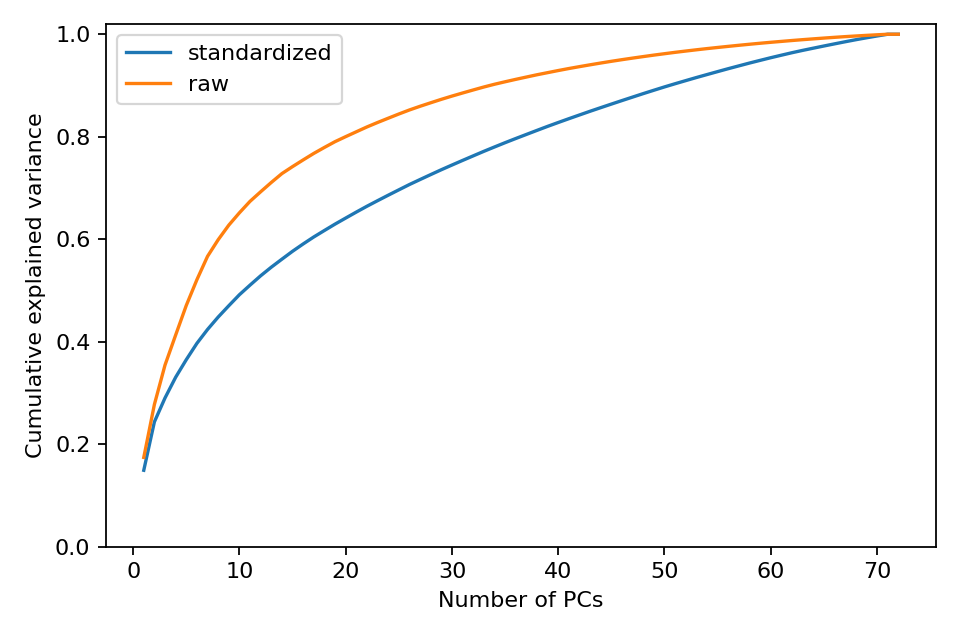
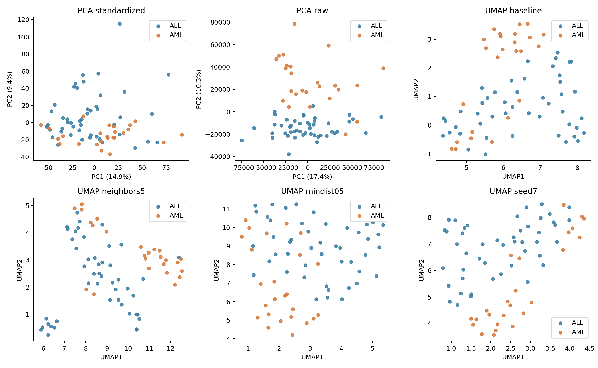

# 第 4 讲教师参考：降维、PCA 与 UMAP

负责人：zhang。对应 [学生工作单](student-worksheet.md) 的四项任务与三道作业。原“第 3 讲b”现独立为第 4 讲；第 3 讲已承担高维数据、距离集中和过拟合的系统教学。

## 教学安排与答案使用

主题：如何把复杂高维数据压缩到可理解的低维空间？建议 45 分钟：0–5 分钟初始判断与目的；5–10 分钟标准化与拟合范围；10–25 分钟 PCA、解释率与 loading；25–37 分钟 UMAP 与单因素对照；37–42 分钟泄露辨析；42–45 分钟退出卡。完整参数实验和可选交叉验证放到课后。教师提前运行 UMAP，避免首次编译占用课堂。

数据仍是 72×7,129 的 Golub 白血病表达矩阵，ALL 47、AML 25。三项元数据均不能进入输入；`sample_id` 只是教学编号，不是原始患者标识。来源和限制见 [数据说明](data/README.md)。不按诊断筛选探针，不直接对含负值的表达值取对数。

PCA/UMAP 描述全部 72 个样本；可选建模对照只使用原始 38 个训练样本进行折内拟合的三折交叉验证，不报告新的测试集性能。降维不保证去噪或提高准确率：本次 PCA(10) 虽压缩特征，但验证均值没有改善。

以下保留实测数值、解释边界和两张正式教学图。复现脚本为 [scripts/teacher_analysis.py](scripts/teacher_analysis.py)；中间坐标、表格和运行信息在项目根目录 `.tmp/dimension-reduction/teacher-results/`，新环境先运行脚本即可生成。

## 任务 1：降维是为了看图，还是预测新样本？

| 目标 | 需要的输出 | 如何判断有用 |
|---|---|---|
| 可视化 | 二维/三维坐标与图 | 是否便于描述样本、对参数是否稳健；不能以分组漂亮代替验证 |
| 去噪 | 保留信号、减少不稳定变化的表示 | 重复测量稳定性或下游验证表现；高方差不自动等于信号 |
| 压缩特征 | 较少坐标，或可重建的近似矩阵 | 维数、存储/计算成本、解释率或适当的重建误差 |
| 发现结构 | 邻域、梯度或候选分组 | 参数和抽样稳定性、外部信息与独立数据验证 |
| 后续建模输入 | 能对未见样本执行同一变换的特征 | 合规交叉验证或保留测试集的性能，以及计算成本 |

**描述流程：**全部 72 行表达数据 → 在全部 72 行拟合标准化 → 在同一数据拟合 PCA/UMAP → 事后用诊断着色 → 描述当前样本结构。允许这样描述，但不能报告为未见样本表现。

**预测流程：**先保留原始 34 个测试样本 → 仅在 38 个训练样本内部交叉验证 → 每一折只在折内训练样本拟合标准化、PCA 和分类器 → 用已拟合变换处理验证折 → 固定方案 → 在全部 38 个训练样本上重新拟合完整 Pipeline → 最终评估保留测试集。若反复根据测试集改方案，测试集便失去了最终独立评估作用。本讲可选实验只在原始训练部分交叉验证，不读取测试标签评分。若曾在第 3 讲查看同一测试集，其成绩也不能再作为本讲调参后的独立验证。

**泄露解释：**全数据 PCA 虽然不使用标签，仍使用验证/测试样本的均值、协方差和变化方向。全数据标准化也使用这些样本的均值与标准差，验证数据已经影响了模型表示。正确做法是把这些步骤放进交叉验证 Pipeline，而不是仅把最后的分类器放进去。

### 可选验证的实际结果

原始训练部分使用分层 3 折，`shuffle=True, random_state=42`。两方案使用同一真实标签和同一折分，PCA 使用完整 SVD、10 个成分；每折训练样本数足够拟合 10 个成分。

| 输入方案 | 第 1 折验证 | 第 2 折验证 | 第 3 折验证 | 验证均值 |
|---|---:|---:|---:|---:|
| 标准化 → 1近邻 | 0.8194 | 0.8750 | 0.8333 | 0.8426 |
| 标准化 → PCA(10) → 1近邻 | 0.6944 | 0.7639 | 0.8333 | 0.7639 |

两方案训练分数均为 1。PCA 在此减少了维度，但验证均值下降，说明最大方差方向不一定保留全部诊断信息。只有三折，不能宣布方案间存在已检验的显著差异；也不能把折间波动直接当成独立样本的置信区间。这些结果没有使用原始测试集。

## 任务 2：PCA 保留了什么，又丢掉了什么？

### 标准化与方差解释

每个探针执行 z_ij=(x_ij−μ_j)/s_j，μ_j、s_j 在本题的全部 72 个样本上计算，s_j 使用 `ddof=0`。本次标准化后最大绝对列均值约 5.98×10⁻¹⁶，列标准差相对 1 的最大绝对误差约 3.33×10⁻¹⁶，属于浮点误差。

这一步使探针以自身变异尺度计量，不能替代微阵列背景校正、跨芯片归一化或批次处理。矩阵有负值，不对其直接取 log 或 log1p。

| 输入 | PC1 解释率 | PC2 解释率 | 前两项合计 | 达到 80% 的成分数 | 达到 90% 的成分数 |
|---|---:|---:|---:|---:|---:|
| 按探针标准化 | 14.9216% | 9.4462% | 24.3678% | 37 | 51 |
| 原尺度，仅中心化 | 17.4278% | 10.3386% | 27.7664% | 20 | 34 |



标准化 PCA 的前两轴仅解释约四分之一的总方差，不能把二维图当作整个数据。标准化与原尺度使用不同的方差度量，两种解释率不能直接比较成“谁保留的生物信息更多”，原尺度累计曲线更快上升也不证明它更适合预测。

### PC1 与 loading 的参考

本题采用 `components_.T` 的单位特征向量权重作为 loading；不是乘以主成分标准差后的 loading，也不是变量与主成分的相关系数。样本 i 的得分是 PC1_i=Σ_j w_j z_ij（这里标准化矩阵已中心化）。

| 标准化 PC1：绝对权重前五个探针 | 带符号权重 |
|---|---:|
| `X92518_s_at` | +0.028786 |
| `X95190_at` | −0.028177 |
| `X98253_at` | +0.027927 |
| `X82895_at` | +0.027871 |
| `Y09616_at` | +0.027757 |

在本次符号约定下，其他输入不变时，`X92518_s_at` 的标准化值增加会提高 PC1 得分，`X95190_at` 增加会降低得分；这描述线性得分，不代表干预效应。完整 PC1 使用全部 7,129 个权重，不能只写这五项就称为完整公式。

| 原尺度 PC1：绝对权重前五个探针 | 带符号权重 | 原始总体标准差 |
|---|---:|---:|
| `M25079_s_at` | +0.352388 | 15,782.80 |
| `hum_alu_at` | +0.313552 | 10,806.78 |
| `HG1428-HT1428_s_at` | +0.234867 | 10,956.53 |
| `L06499_at` | +0.210453 | 7,625.23 |
| `J04617_s_at` | +0.196253 | 6,846.94 |

两种前五名单不同。原尺度前五个探针的标准差很大，而标准化名单中五个探针的原始标准差约为 327–531，支持尺度影响主成分方向。标准化减少绝对尺度支配，但也可能放大小变异、低信噪比特征；不能把任何一种处理当作无需验证的唯一答案。

### 概念问题参考

- **PC1 最大化什么？**在单位长度方向约束下，最大化当前输入矩阵投影后的样本方差。后续方向与前面的方向正交，依次解释剩余方差。
- **PC1 是最佳诊断方向吗？**不是。PCA 不使用诊断标签；大方差可能来自疾病、细胞组成、技术变化或其他因素，本表没有信息能把它唯一归因于某种机制。
- **PC1 是一个基因吗？**不是，它是全部输入特征的线性组合，且这里的列是探针。高绝对权重也不是差异表达显著性、分类重要性或因果证据。
- **符号翻转有影响吗？**将所有权重与相应得分同时乘以 −1，只是翻转坐标轴，不改变解释率、样本距离或投影信息。学生整体符号相反可以完全正确。
- **为什么至多 71 个非零主成分？**72×7,129 矩阵按列中心化后，72 行之和为零，因此秩不超过 min(72−1,7,129)=71。软件可输出 72 项，但最后一项只可能是零或数值误差。大量特征不保证存在同样多的可估计独立方向。

**一句解释示例：**标准化 PC1 是本组探针共同变化最大的线性方向，解释总方差约 14.92%，它综合了许多探针的正负加权变化。

**一句边界示例：**不能据此将 PC1 命名为“白血病严重程度”，也不能把其最大权重探针称为已经验证的致病基因。

## 任务 3：UMAP 上的簇可以相信到什么程度？

### 方法比较参考

| 比较项 | PCA | UMAP |
|---|---|---|
| 线性/非线性 | 线性投影 | 非线性嵌入 |
| 主要目标 | 依次最大化正交方向的方差；固定维数下最小化相应平方重建误差 | 构建近邻图并优化低维表示，侧重局部邻域关系 |
| 轴的含义 | 输入特征的带权线性组合 | 嵌入坐标轴，无对应的固定生物学单位 |
| explained variance ratio | 可以报告 | 没有与 PCA 等价的解释率 |
| 距离的解释 | 在线性子空间保留部分欧氏结构，但截断后距离仍会失真 | 邻近可作为局部相似线索；远处岛屿间的距离与大小不能直接量化生物差异 |
| 参数与随机性 | 标准化和成分数重要；本题完整 SVD 基本确定，符号不唯一 | 邻居数、min_dist、度量和随机种子影响结果 |
| 预测中的使用 | 在训练折拟合，再变换验证样本 | 如作为输入，也必须训练折拟合并用支持的 transform 处理验证样本，不能对全数据先嵌入 |

UMAP 常用于单细胞与复杂表型，因为许多样本关系难以由两个线性方向充分展示，而邻域图有助于表达局部非线性结构。这不保证它保留了所有真实关系，也不保证本数据上一定比 PCA 更有生物意义。

### 实际参数对照

四种设置均直接输入同一 72×7,129 标准化矩阵，不先按诊断选列，也不预先压缩为另一套输入；度量固定为欧氏距离，`n_jobs=1`。



除图形外，用一个简单的教师辅助描述量检查邻域：对每个样本取 5 个最近邻，计算两个空间的邻居交集数量/5，再对 72 个样本取平均。自身被排除；该量不是准确率、显著性检验或 UMAP 解释率，也不是标准 trustworthiness 指标。

| 设置 | n_neighbors | min_dist | 种子 | 原高维5近邻保留比例 | 与基线二维5近邻的重合比例 |
|---|---:|---:|---:|---:|---:|
| 基线 | 15 | 0.1 | 42 | 41.11% | 100.00% |
| 只改邻居数 | 5 | 0.1 | 42 | 45.56% | 55.28% |
| 只改 min_dist | 15 | 0.5 | 42 | 40.00% | 64.17% |
| 只改种子 | 15 | 0.1 | 7 | 40.56% | 60.28% |

例如 G001 在四张 UMAP 图的 5 近邻中始终包含 G003、G004、G008、G049；G004 的五个近邻在四种设置中全部相同。G010 则没有四种设置共有的 5 近邻。完整列表见 [稳定邻域记录](../../../.tmp/dimension-reduction/teacher-results/umap-stable-neighbors.csv)，这些“稳定”仅针对本次四种设置，不是已获得外部验证。

改变种子后平均邻域重合约 60.28%，说明部分局部关系保留、部分改变；改变邻居数后约 55.28%。不能将单张图当作唯一布局。min_dist 较大通常限制局部点的紧密堆积，n_neighbors 较小更强调较小尺度的邻域，但具体图形须看本次实际结果。

### 对“岛屿”和生物学意义的回答

工作单没有定义聚类算法或“岛屿”的数量判定阈值，因此不存在可以直接从图上报出的唯一正确簇数。可描述某种设置下的视觉聚集，并比较它在其他设置下是否保持；若声称簇数稳定，须补充明确的判定方法与稳定性证据。方向可以旋转或反射，坐标平移没有生物学意义；岛屿面积、点密度与岛屿间距离也不应直接解释为疾病数量、患病率或机制差异大小。

**三条判断参考：**

1. 图和邻域对照支持“本组样本存在部分稳定的局部相似关系”；不能推出“所有局部关系都被完整保留”。
2. 标签着色可以探索样本排列是否与已知诊断相符；即使出现清晰分离，也不能推出“两种簇就是两种疾病机制”或“发现了新的真实亚型”。
3. 图不能评估未见患者的预测表现，也不能排除批次效应。本数据缺少批次与中心字段，无法做相应调整或核验，不能写成“已证明没有批次影响”。

高维距离本身也受噪声和尺度影响，所以“保留原邻居更多”不是唯一优劣标准。本表不用于根据诊断或测试表现选择最佳 UMAP 参数。

## 任务 4：给研究团队写一份结论

### 四句结论参考

**主张：**二维图可以帮助提出结构假设，但不能单独证明疾病机制或新患者预测能力。

**证据：**标准化 PCA 的前两轴只解释 24.37% 的方差，UMAP 仅改变种子就使平均 5 近邻重合比例降到约 60.28%。

**推理：**低维表示与未见样本预测是不同证据；PCA 保留最大方差方向，UMAP 侧重局部邻域，二者都可能损失或重排信息，因此应结合分析目标、参数稳定性和合规验证判断。

**边界：**结果只涉及当前小样本与固定分析方案；若要主张机制，应进一步核对探针注释并开展针对候选机制的功能实验，若要主张临床预测能力，应在预先固定完整流程后用独立患者队列验证，并收集批次信息。

### 本讲三道作业参考

**1. PCA 第一主成分代表什么？**它是当前输入中投影方差最大的单位长度线性方向，每个样本的得分由全部探针加权得到。本次标准化 PC1 解释 14.92% 的总方差，`X92518_s_at` 权重约 +0.028786；这个数字是方向系数，不是该探针对疾病的因果效应。PC1 也不是分类器为了分开 ALL/AML 找出的方向。

**2. 为什么 PCA 前通常需要考虑标准化？**PCA 依赖方差，数值尺度大或变异大的特征可能占优势。本次原尺度与标准化 PC1 的前五权重名单完全不同，前两项解释率分别为 27.77% 与 24.37%，表明预处理改变了所强调的变化。标准化让不同探针按自身变异尺度比较，但可能放大低信噪比特征；它的合理性取决于测量与分析目标，不能只看解释率谁大。

**3. UMAP 图能说明什么，不能说明什么？**它可展示当前预处理和参数下的局部相似结构，并用诊断着色提出假设。本次仅将种子从 42 改为 7，二维 5 近邻平均重合约 60.28%，说明布局并非唯一；它不能直接给出疾病机制、真实簇数、簇间生物差异大小或新患者预测准确率。

## 讲评与评分提醒

优先检查分析单位、拟合范围和证据解释，再核对数字。概念题允许不同表述；整体翻转 PCA 符号、UMAP 图的旋转/平移以及不同软件版本产生的合理差异，不应直接判错。若使用不同标准差约定、软件版本或划分，学生须报告差异，不能声称与本参考完全相同。

应明确纠正：把 7,129 个探针写成 7,129 名患者或不同基因；让诊断进入降维输入；全数据标准化/PCA 后交叉验证；把解释率当分类准确率；把降维自动等同于去噪；把高 loading 当致病证据；把 UMAP 岛屿直接命名为真实亚型。

## 复现与证据索引

本次运行环境为 Python 3.13.12、NumPy 2.3.5、pandas 2.3.3、SciPy 1.17.1、scikit-learn 1.8.0、umap-learn 0.5.12、Matplotlib 3.10.8。版本及输入文件 SHA-256 记录于 [summary.json](../../../.tmp/dimension-reduction/teacher-results/summary.json)。UMAP 固定种子和单线程；跨版本、平台仍可能有数值或布局差异。

在本单元目录运行：

```powershell
python -m pip install -r scripts/teacher-requirements.txt
python scripts/teacher_analysis.py
```

脚本定位自身所在目录来读取数据，可从其他工作目录通过完整路径运行。它会更新项目根目录 `.tmp/dimension-reduction/teacher-results/` 下的实验产物，不改写源数据；首次 UMAP 运行可能因编译耗时。本文是人工编写的解释，修改分析方案后应同步核对文中的数值。

| 证据 | 文件 |
|---|---|
| 训练部分的 PCA 建模对照 | [cross-validation.csv](../../../.tmp/dimension-reduction/teacher-results/cross-validation.csv) |
| PCA 解释率与累计解释率 | [pca-variance.csv](../../../.tmp/dimension-reduction/teacher-results/pca-variance.csv) |
| PCA 前五权重与原始标准差 | [pca-loadings.csv](../../../.tmp/dimension-reduction/teacher-results/pca-loadings.csv) |
| PCA 样本坐标 | [标准化](../../../.tmp/dimension-reduction/teacher-results/pca-standardized-coordinates.csv)、[原尺度](../../../.tmp/dimension-reduction/teacher-results/pca-raw-coordinates.csv) |
| UMAP 样本坐标 | [基线](../../../.tmp/dimension-reduction/teacher-results/umap-baseline-coordinates.csv)、[邻居数5](../../../.tmp/dimension-reduction/teacher-results/umap-neighbors5-coordinates.csv)、[min_dist=0.5](../../../.tmp/dimension-reduction/teacher-results/umap-mindist05-coordinates.csv)、[种子7](../../../.tmp/dimension-reduction/teacher-results/umap-seed7-coordinates.csv) |

学生工作单未要求邻域保留比例等教师辅助量，不应把这些补充量设为学生必须提前知道的评分门槛。
